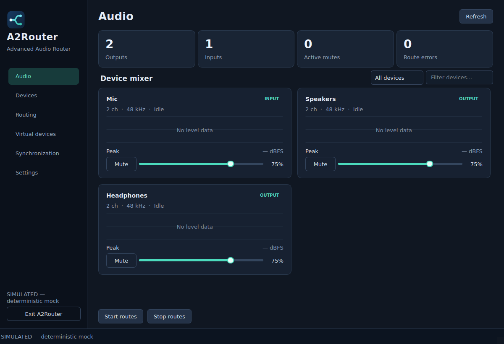
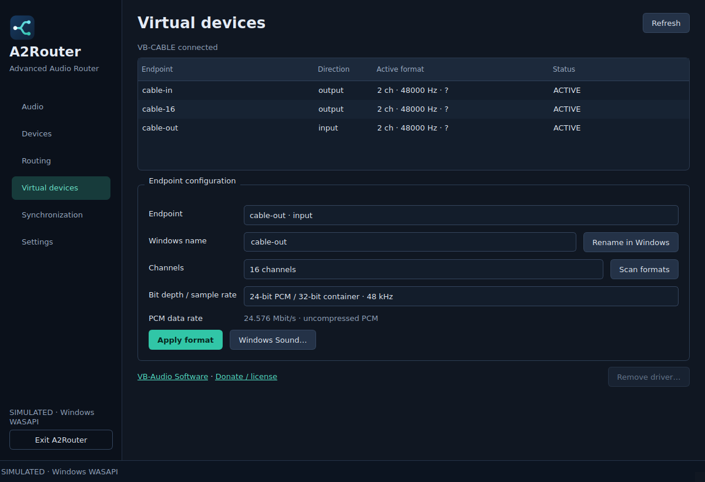

# A2Router — Advanced Audio Router

A compact desktop application for routing audio from multiple sources to multiple outputs. The interface uses Python and Qt Widgets; audio transport runs in PipeWire on Linux and the native C++ WASAPI engine on Windows.

**Built on [vkr-6/MultiRoute](https://github.com/vkr-6/MultiRoute), originally [FulminataXII/MultiRoute](https://github.com/FulminataXII/MultiRoute). Developed with OpenAI Codex under the project owner's direction.** Original engine authorship and dependency credits are detailed below.

## Features and current status

- Discover inputs, outputs and output monitors, with reported active formats and channel layouts.
- Create, enable, disable and remove concurrent device-level routes; support fan-out and multiple sources per destination.
- Save and restore versioned JSON configurations and profiles, retaining unavailable-device definitions.
- Linux: real PipeWire virtual outputs through `pipewire-pulse`, with mono, stereo, 5.1 and 7.1 layouts; owned-resource cleanup and reconnection support.
- Windows: reuse MultiRoute's WASAPI engine for input capture and output loopbacks, with native drift compensation and telemetry.
- Windows uses the original VB-CABLE base package, installed only when you click **Create output** in **Virtual devices**. The application itself remains portable.
- Optional Windows channel routing: explicit channel remapping, duplication and summing, with per-connection gain and clipping protection in C++. Standard device routes retain the original WASAPI processing path.
- A redesigned **Audio** main page with a device mixer, measured peak-history graphs, master volume/mute, device filtering and route status. Sidebar navigation keeps routing, virtual endpoints, synchronization and settings separate.
- Windows virtual endpoint configuration: exact format probing, channel count, bit depth/sample rate, PCM data rate and real Windows endpoint renaming. Advanced controls report failures and verify changes.
- Live delay adjustment and stable refresh preserve selection, route state and unapplied edits.

**Windows driver operations and the updated WASAPI channel path need target-machine validation.** The base VB-CABLE package supplies one shared cable, not arbitrary named devices. The Virtual devices page can rename Windows endpoints and apply driver-supported formats. Format changes use an isolated Windows compatibility interface with verification/rollback; Windows Sound remains a fallback. These native operations require target-machine validation. Windows audio signal transport and acoustic alignment are unverified for this revision. See [verification scope](docs/verification.md).

## Interface

The **Audio** page is the main workspace. Device cards expose master volume and mute, plus 30 seconds of observed Windows endpoint peaks on a −60 to 0 dBFS graph. Meter polls run on the control worker and do not rebuild or restart routes. Missing telemetry is shown as unavailable; no waveform data is simulated in the real backend. PipeWire volume/mute are supported through `pactl`; live Linux peak capture is not implemented.



*Preview captured from the actual Qt application with a labelled simulated backend; no audio hardware validation is implied.*



*Configuration preview uses simulated Windows endpoints. The 16-channel choice is a tested UI path, not proof that a particular driver accepted a real change.*

The interface uses compact device strips and clear function separation inspired by established utilities such as [EarTrumpet](https://eartrumpet.app/) and [RME TotalMix FX](https://rme-audio.de/totalmix-fx.html). The layout, assets and implementation are A2Router's own; it has no effects or controls that the backend cannot implement.

## Build with GitHub Actions

Push this source tree to your repository. The [A2Router build workflow](.github/workflows/build.yml) is **manual-only**: start it from **Actions → A2Router build → Run workflow**. Pushing commits or opening pull requests does not trigger builds.

| Job | Output / checks |
|---|---|
| Windows x64 portable application | Builds the native engine/bridge, checks the ABI, packages one GUI EXE with the icon, theme and VB-CABLE payload, and runs labelled simulated startup tests |
| Linux | Python lint/format checks, Python and native tests, isolated real PipeWire integration |

After a successful run, download from the run's **Artifacts** section:

- **A2Router-windows-x64**: portable GUI application, checksums, runtime notices and build reports. Launch `a2router.exe` after extracting.
- **A2Router-windows-x64-zip**: the same portable application in a distributable ZIP.

Hosted Windows runners use the simulated backend for packaged GUI checks and load the actual DLL to verify its ABI. Endpoint-dependent tests are skipped there; local non-headless builds can run endpoint discovery checks. Hosted runners do not prove real speaker playback, microphone capture quality or acoustic synchronization. The workflow does not install drivers, enable test signing, change audio defaults, or publish a release. The updated workflow has not been dispatched during source preparation.

When using a new GitHub repository, point your existing remote at it before pushing:

```bash
git remote set-url origin https://github.com/YOUR_ACCOUNT/A2Router.git
git add .
git diff --cached --stat
git commit -m "Add A2Router application and build workflows"
git push -u origin HEAD
```

Use your actual repository URL. Do not commit generated dependencies, VM images, certificates or build outputs; these are ignored. Local `prompt.md` and `progress.md` continuation notes are retained on disk but excluded from Git and source distributions.

## Linux setup

On a native Ubuntu/Debian PipeWire desktop:

```bash
sudo apt install python3-venv pipewire pipewire-pulse wireplumber pulseaudio-utils
python3 -m venv .venv
. .venv/bin/activate
python -m pip install -e '.[test]'
python -m a2router diagnostics
python -m a2router gui
```

Run as your normal desktop user. `pactl info` must connect to the intended audio server. In **Virtual devices**, create a named output and select it in the source application's sound settings. In **Routing**, select that virtual output's monitor and a physical destination. Add another route for another output. Matching channel layouts are required; implicit surround downmixing is rejected. Microphone monitoring requires explicit feedback-risk confirmation.

PipeWire supplies transport, mixing and clock management. Adjustable delay is not currently exposed on Linux. See [Linux details](docs/linux.md).

## Windows portable application and local build

Install Python 3.12 x64, Visual Studio 2022 with Desktop C++, a Windows SDK and CMake. From the project root:

```powershell
py -3.12 -m venv .venv
.venv\Scripts\python -m pip install -e ".[test]"
cmake -S . -B build -A x64
cmake --build build --config Release
.venv\Scripts\python -m a2router diagnostics
.venv\Scripts\python -m a2router gui
```

The bridge is `build/a2router_wasapi.dll`; `A2ROUTER_WASAPI_DLL` overrides its path. To build portable EXEs from a Visual Studio developer shell:

```powershell
powershell -ExecutionPolicy Bypass -File tools/windows/build-portable.ps1
```

Outputs are `dist/windows-x64/` and `dist/a2router-windows-x64.zip`. The script uses `%LOCALAPPDATA%\a2router-build` for temporary work, or the directory supplied with `-Workspace`. `-Headless` uses simulated packaged smoke checks, skips endpoint-dependent tests and omits native desktop startup; `-SkipTests` skips automated and packaged smoke checks. No Python installation is needed to run the packaged EXEs.

### Virtual output: install on demand

1. Extract the complete portable ZIP and launch `a2router.exe`. Starting the app, refreshing devices and restoring profiles never install a driver.
2. Open **Virtual devices**. An existing cable appears automatically, identified through its audio-adapter topology or original VB-Audio adapter branding. **Add VB-CABLE** is offered only when absent; Windows requests administrator approval for that explicit installation. Starting A2Router never installs a driver.
3. A2Router waits for the original vendor installer, verifies PnP status and refreshes active audio endpoints automatically. A ready endpoint is usable immediately. If Windows reports a restart pending, or no endpoint becomes active, the app reports the restart requirement; it never restarts your computer automatically.
4. Select the playback **or recording** endpoint in **Endpoint configuration**, then **Scan formats**. Only exact driver-accepted formats are offered. Choose a channel count (including 2, 6, 8 or 16 when reported), bit depth and sample rate, then **Apply format**. Stop managed routes using the endpoint first. Playback and recording formats are separate: configure the recording endpoint too when routing a multichannel cable source. The custom routing editor then exposes all active channels instead of assuming left/right.
5. **Rename in Windows** changes the selected endpoint's system-visible name while retaining its stable ID and saved routes. The portable application requests elevation if Windows requires administrator access. Older display aliases are removed for that renamed endpoint. **Windows Sound…** remains available if configuration is unsupported on a particular Windows version.
6. Send applications to **CABLE Input**; route **CABLE Output** to one or more physical outputs in A2Router. **CABLE In 16 Ch**, when present, belongs to the same cable. Feedback to either playback alternative is blocked.
7. To uninstall the driver, remove its routes and choose **Remove driver…** in Virtual devices. Confirm explicitly: this affects every application using VB-CABLE. Removal may require a restart. To remove A2Router itself, exit it and delete its portable folder; saved settings are in `%APPDATA%\a2router`.

Keep the `vendor` folder beside the EXEs. Package extraction checks the pinned original ZIP hash; driver operations check the vendor installer's Authenticode signature. No custom WDK driver, Inno setup EXE, test-signing configuration or automatic driver installation is used. Windows itself may change default audio devices during driver installation; review Sound settings. A2Router does not explicitly set defaults.

**VB-CABLE is donationware by [VB-Audio Software](https://www.vb-cable.com/). Donations and license purchases are welcome.** The unchanged vendor package/license is included; professional deployments may require separate licenses. [Bundling terms](https://vb-audio.com/Services/licensing.htm). Additional A/B/C/D cables are not included. See [driver integration](drivers/windows/README.md).

### Optional channel routing

On Windows, select endpoints in **Routing**, then enable **Custom channel routing** before adding the route. Each row connects one source channel to one destination channel with gain from −60 to +12 dB. Add rows to duplicate a source channel or sum several channels into one destination. Duplicate identical connections are rejected; change their gain instead. Unmapped destinations are silent; omitting source channels requires confirmation in the GUI. Turn the option off for normal whole-device routing.

The native path accepts reported float32 or PCM16/24/32 sources, accumulates in double precision and emits float32 to WASAPI using the destination's channel layout and the source's sample rate. Windows may convert/resample to the hardware format. Mixed peaks are hard-limited to ±1; clipped samples appear on Synchronization. Lower gains to avoid clipping. These processed routes are not bit-perfect. Channel maps/gains are saved in profiles. Changing route topology restarts that source's native session; live gain editing is not currently exposed. Linux custom matrices are disabled; normal PipeWire device routing is preserved.

### Synchronization and stable refresh

Select a route on **Synchronization**, edit the additional delay, then Apply. Draft values survive focus changes and periodic refreshes; Discard restores the saved request. Native live-delay adjustment is used within the current buffer. A larger adjustment can restart that source only if **Allow a source restart** is selected. The page shows route state, requested delay, actual buffer/target, rate correction and underruns. Existing native drift compensation remains automatic; acoustic alignment still requires measurement.

Periodic refresh updates changed cells in place, preserving selections and scroll positions. It does not rebuild lists, flash the Updating message or disable controls. A click made while polling is queued instead of discarded. Polling does not restart healthy routes.

See [Windows details](docs/windows.md) and [clean-machine testing](docs/testing.md).

## Source diagnostics and lifecycle

```bash
python -m a2router diagnostics
python -m a2router devices
python -m a2router routes
python -m a2router gui
python -m a2router create-virtual "Application bus" --layout stereo
python -m a2router add-route SOURCE_ID DESTINATION_ID
python -m a2router disable-route ROUTE_UUID
python -m a2router enable-route ROUTE_UUID
python -m a2router remove-route ROUTE_UUID
python -m a2router remove-virtual VIRTUAL_UUID
python -m a2router save studio.json
python -m a2router load studio.json
```

The distributed portable build contains only `a2router.exe`; no separate CLI or native console artifacts are shipped. The following source diagnostics remain available to developers. Use device IDs returned by `devices`. Read-only diagnostics do not activate saved routes. `python -m a2router --mock gui` uses a clearly labelled simulation and separate state. Windows CLI processes cannot sustain routing after exit; use the GUI.

Closing the window hides/minimizes it. **Exit controller** leaves Linux server resources running but stops Windows processing. **Stop all managed routes** explicitly disables routes. Configuration restoration creates managed virtual devices before dependent routes; missing endpoints remain pending. Default speakers/microphones are not explicitly changed by the application.

## Development checks

```bash
python -m pip install -e '.[test]'
ruff check a2router tests tools/windows
ruff format --check a2router tests tools/windows
python -m pytest -q
cmake -S . -B build -DCMAKE_BUILD_TYPE=Release
cmake --build build --parallel
ctest --test-dir build --output-on-failure
```

On Windows use `--config Release` for the build and `-C Release` for CTest. For isolated Linux audio integration, install the PipeWire utilities listed above and run:

```bash
dbus-run-session -- python tests/run_private_pipewire.py
```

Standard tests skip opt-in real-audio cases. Mock success and a successful CI build do not establish hardware audio or driver correctness. Windows hardware playback, native matrix integration and actual driver operations need target-machine validation.

## Source structure

```text
a2router/              Qt UI, controller, configuration, platform backends
src/                   MultiRoute WASAPI engine, C ABI bridge, native channel matrix
vendor/vbcable/        Original VB-CABLE archive, checksum enforcement and notices
drivers/windows/       VB-CABLE integration documentation
tests/                 Python, C++ and opt-in audio integration tests
tools/windows/         Portable builds, on-demand vendor installer, diagnostics
docs/                  Platform setup, architecture and verification scope
.github/workflows/     GitHub Actions builds and checks
CMakeLists.txt         Native C++20 application build
pyproject.toml         Python dependencies and entry point
THIRD_PARTY_NOTICES.md  Upstream attribution and dependency notices
```

## Credits and licensing

- **[vkr-6/MultiRoute](https://github.com/vkr-6/MultiRoute)** — source repository used as the foundation for A2Router's Windows engine.
- **[FulminataXII/MultiRoute](https://github.com/FulminataXII/MultiRoute)** — original upstream audio-routing project. Credit to its authors for the WASAPI engine, ring buffers, drift controllers, telemetry and original frontends.
- **[VB-Audio Software](https://www.vb-cable.com/)** — VB-CABLE virtual audio driver by Vincent Burel / JS-Loezic. The original Pack45 ZIP and vendor license are preserved unchanged. VB-CABLE is donationware; contributions are welcome.
- **OpenAI Codex** — AI coding assistant used to develop the A2Router application additions, Linux backend, Qt interface, configuration handling, Windows integration, driver adaptation, documentation and workflows under the project owner's direction. This development credit does not replace upstream authorship or imply verified correctness.

No standalone license file was present in the imported MultiRoute checkout. A2Router does not assign a new blanket license to that existing engine. VB-CABLE retains its own proprietary donationware license; it is not A2Router-authored code. See [third-party notices](THIRD_PARTY_NOTICES.md) for attribution and component licensing. Original [MultiRoute documentation](docs/upstream-windows.md) is retained.
