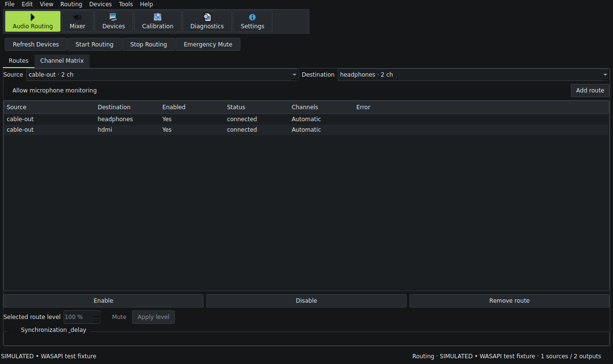
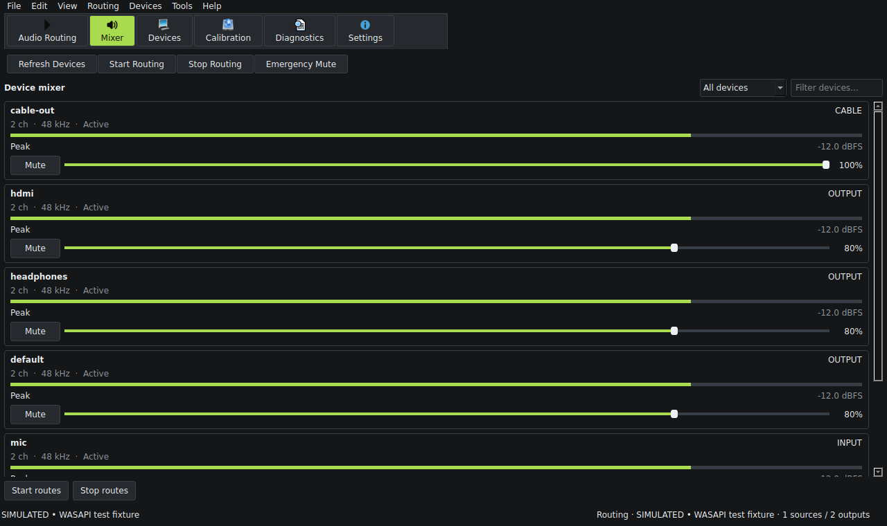

# A2Router — Advanced Audio Router


Portable audio routing for Windows WASAPI and native Linux PipeWire desktops.
Python/PySide6 provides the interface; native audio transport stays in C++ or the
audio server. Built on [vkr-6/MultiRoute](https://github.com/vkr-6/MultiRoute),
originally [FulminataXII/MultiRoute](https://github.com/FulminataXII/MultiRoute).
Developed with **OpenAI Codex** under the project owner's direction.

## Interface

- **Audio Routing:** select a source/destination, manage concurrent routes and open
  optional Channel Matrix or Synchronization & delay. No showcase device tables,
  Advanced Processing page or Route Monitor page.
- **Mixer:** compact observed level meters, endpoint controls and one logical
  VB-CABLE strip. Cable volume/mute controls A2Router's native routed streams;
  the input meter measures the incoming cable signal before that gain.
- **Devices:** physical/virtual inventory, shared-cable status and configuration
  together. Select an endpoint, scan exact supported formats, and apply supported
  channels/bit depth/sample rate. Windows/vendor names remain unchanged.
- **Calibration:** microphone-assisted sequential chirps, repeated-pass correlation,
  confidence/spread, cancellation and reviewed compensation. Measurement does not
  automatically apply delays. Native Windows playback/capture needs hardware testing.
- **Diagnostics:** actual backend observations, action/error log and reviewed export.
- **Settings:** complete White, Dark, Lime, Blue, Violet and system-following themes.
  Profiles appear only in **File** (New/Open/Save/Save As/Recent profiles).




These are actual Qt screenshots with explicitly simulated native APIs. They do not
prove hardware playback, calibration accuracy or driver behavior. See the
[user guide](docs/user-guide.md) and [verification report](docs/upgrade-report.md).

## Manual builds and downloads

The workflow remains **manual-only**, with independent choices for:

| Workflow choice | Outputs |
|---|---|
| Windows portable | `a2router-windows-x64.zip`, portable app folder |
| Windows setup | `a2router-windows-x64-setup.exe`, SHA-256 checksum |
| Linux | `a2router-linux-x86_64.tar.gz`, `a2router_0.1.0_amd64.deb`, checksums |

Push the source, then **Actions → A2Router build → Run workflow**. Choose the targets.
Windows and Linux build separately. Download the artifacts after the selected jobs
pass. The setup EXE embeds the application runtime and vendor driver payload in one
file. CI compiles it but never runs it or installs the audio driver.

### Windows

The portable ZIP needs no application installation or Python. Extract the complete
folder and run `a2router.exe`. Keep `vendor` beside it. No separate console EXE is
shipped; source CLI diagnostics remain compatible.

Setup offers desktop/Start menu shortcuts, launch, and **unchecked-by-default**
VB-CABLE installation. The app installs per user. The driver alone requests
administrator approval. Uninstall has a separate **unchecked** option to remove
VB-CABLE, with a warning that it is shared by other applications; silent uninstall
retains it. Saved profiles are retained. Restart is requested only when reported
necessary, never forced. Close A2Router/audio apps before replacing files or removing
its driver. Windows itself may choose new defaults during driver installation;
A2Router does not explicitly change system default devices.

The driver can also be added explicitly from **Devices → Configure**. One base
VB-CABLE installation supplies a shared cable with multiple playback/recording pins,
not unlimited independent devices. Endpoint renaming has been removed from the UI.
Format changes require stopping dependent managed routes. Driver authenticity checks,
original files, license notices and PnP verification remain intact.

Build locally with Python 3.12 x64, Visual Studio 2022 Desktop C++, a Windows SDK,
and Inno Setup 6.3+ or 7 for setup:

```powershell
./tools/windows/build-portable.ps1 -Workspace "$env:TEMP/a2router-build" -Headless
./tools/windows/build-setup.ps1
```

The portable script creates its build venv in that workspace. The setup script only
uses an existing compiler; it never installs a compiler or executes the installer.
The hosted workflow can provision its own build-runner compiler.

### Linux

Tarball: extract and run `./a2router`; Python/Qt/NumPy are bundled. PipeWire,
pipewire-pulse, pactl and desktop Qt/XCB libraries remain system dependencies.
Debian/Ubuntu: `sudo apt install ./a2router_0.1.0_amd64.deb` installs the bundle and
desktop launcher with declared dependencies. No driver/application service is added.
CI targets Ubuntu 22.04+ compatible glibc systems. Locally generated artifacts reflect
the local build host; this session's package was built on Ubuntu 24.04/glibc 2.39.

From source:

```bash
sudo apt install python3-venv pipewire pipewire-pulse wireplumber pulseaudio-utils cmake g++
python3 -m venv .venv
. .venv/bin/activate
python -m pip install -e '.[test,build]'
python -m a2router gui
bash tools/linux/build.sh
```

See [Linux package dependencies](tools/linux/README.txt). Windows-only calibration,
stream controls and channel matrices are capability-gated on Linux; existing
PipeWire device routing, mixing, virtual sinks and endpoint volume/mute remain.

## Channel conversion and calibration

Channel Matrix supports explicit remapping, duplication, summing and gains, using
reported channel positions/counts. New presets include stereo/mono downmix and
stereo-to-surround expansion. Downmix excludes LFE and preserves front-channel level by default; optional
−3 dB headroom and worst-case peak normalization are selectable. Upmix
creates explicit duplicates/centre contributions and leaves LFE silent. It does not
recover discrete surround or implement bass management. Unknown channel positions
require a custom map. The stereo fold-down uses [ITU-R BS.775-style contributions](https://www.itu.int/rec/R-REC-BS.775/);
7.1 pair handling and headroom selection are explicit application choices.
Reload and apply a preset to update an existing saved matrix; custom gains are
never silently rewritten.

Calibration uses native WASAPI microphone recording and first-output-channel chirps,
with offline NumPy matched filtering. Keep the microphone fixed and other audio
quiet. It measures relative arrival against a monotonic software-start reference;
room propagation, hardware/transport latency and startup jitter are not separated.
Confidence is a heuristic correlation/consistency score, not an accuracy guarantee.
Review compensation before Apply; earlier outputs receive additional delay relative
to the slowest measured output. Native delay requests currently use integer ms.
Results include stable IDs, timestamp, method and quality metadata in profiles.

Standard routes reuse the existing engine and native drift compensation. Mixing,
conversion, gain, sample-rate adaptation and channel processing are not bit-perfect.
No sample-perfect multi-device or acoustic alignment claim is made.

## Verification and development

```bash
ruff check a2router tests tools
ruff format --check a2router tests tools
python -m pytest -q
cmake -S . -B build/native -DCMAKE_BUILD_TYPE=Release
cmake --build build/native --parallel
ctest --test-dir build/native --output-on-failure
```

Windows multi-config builds use `--config Release` and CTest `-C Release`.
Opt-in private Linux graph tests: `dbus-run-session -- python tests/run_private_pipewire.py`.
No Windows compiler/audio hardware validation was performed in this session. Offline
algorithm, control simulation and offscreen GUI tests do not establish that the new
Windows DLL, setup or acoustic path works on a real target. See [verification](docs/upgrade-report.md).

## Credits and license

- **vkr-6/MultiRoute** and **FulminataXII/MultiRoute**: original WASAPI engine,
  buffering, drift controllers, telemetry and native frontends.
- **VB-Audio Software / Vincent Burel / JS-Loezic**: original VB-CABLE Pack45 driver.
  [VB-CABLE](https://www.vb-cable.com/) is proprietary donationware;
  [donations/licensing](https://vb-audio.com/Services/licensing.htm) remain applicable.
  Vendor files and notices are unchanged; additional A/B/C/D cables are not bundled.
- **OpenAI Codex**: application development, integration, UI, documentation and build
  automation under the owner's direction. This credit does not replace upstream
  authorship or imply hardware verification.

Original A2Router contributions use the [MIT license](LICENSE), with explicit
[exclusions](LICENSING.md). The imported MultiRoute engine has no license in this
snapshot and cannot be relicensed by A2Router. VB-CABLE and runtime dependencies
retain their own terms. See [third-party notices](THIRD_PARTY_NOTICES.md).

## Cable volume controls

In Mixer, Cable volume selects either A2Router routed playback or the Windows
playback endpoint. These are separate gain stages; changing scope does not reset
or multiply either value automatically. Endpoint mode reads back Windows values
and reflects changes made outside A2Router.

If the Windows sound slider does not affect VB-CABLE audio, open **VB-CABLE
panel…** and enable **Windows Volume Control** in its menu. The vendor documents
that the playback volume control has no effect while this option is disabled:
[VB-CABLE reference manual, Windows Volume Control](https://vb-audio.com/Cable/VBCABLE_ReferenceManual.pdf).
A2Router verifies the original control-panel binary before launching it and never
runs the installer from this action. Driver options are not changed automatically.

Linux PipeWire 1.0+ now exposes a per-route server latency target with explicit
permission to restart that route. This is a server buffering request, not measured
acoustic alignment. Linux custom channel matrices, acoustic calibration and
per-route DSP/gain remain unsupported; endpoint volume/mute, virtual sinks,
fan-out, many-source server mixing and profiles are supported.
